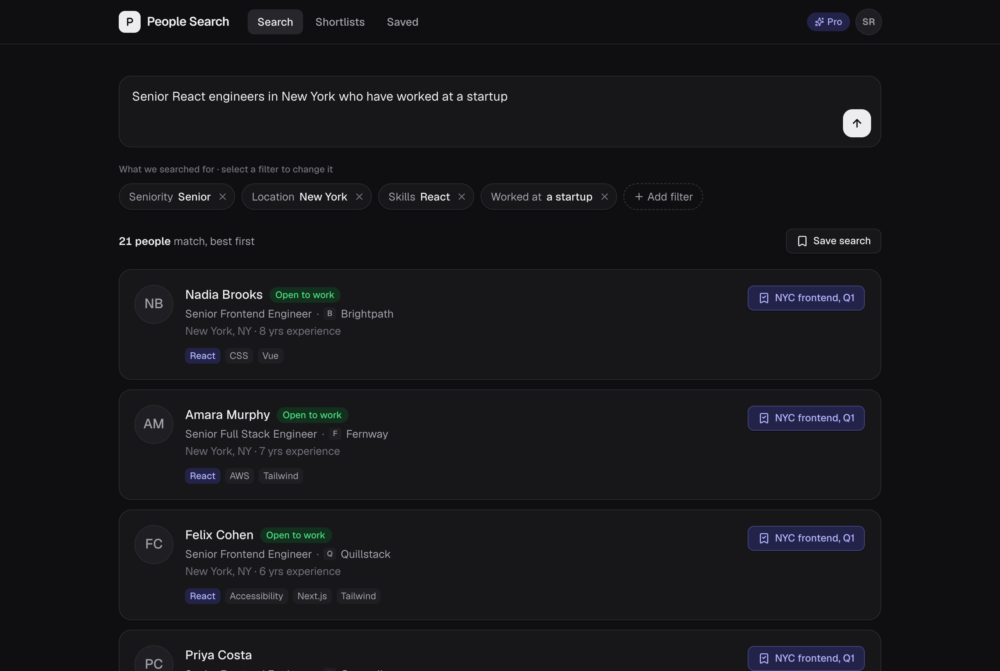
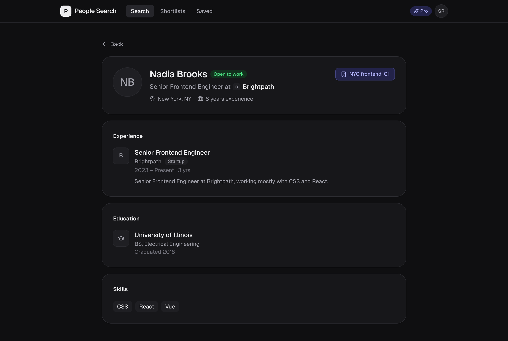
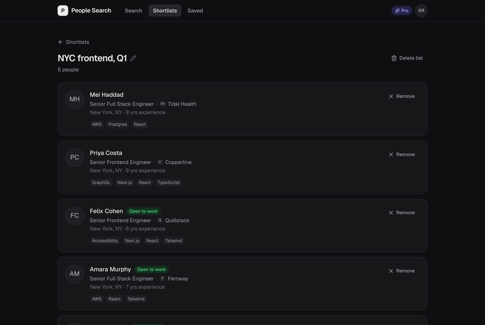

# People Search

Describe who you're looking for in plain English ("senior React engineers in New York who have worked at a startup") and get a ranked list of matching candidates. Recruiters from different companies share one candidate pool but see only their own shortlists, saved searches and plan. Built with Next.js 16, local Supabase (Postgres with row-level security) and Claude Haiku 5.5.

| Candidate profile | Shortlist |
|---|---|
|  |  |

`make setup` then `make dev` → http://localhost:3000 (needs Node 24 and Docker running). Put `ANTHROPIC_API_KEY` and `STRIPE_WEBHOOK_SECRET` in your shell or `.env.local`. Sign in as `recruiter@acme.test` or `recruiter@globex.test` (password `people-search-demo`). `make dev` serves a production build, so timings are realistic; `make watch` hot-reloads.

## How search works
1. **Brief → filters.** Claude Haiku 5.5 reads the brief and returns structured output whose JSON schema is built from `search_vocabulary()`: every role, city, skill, company, school, degree and field that actually exists in the data, as enums. It returns only the conditions it uses, e.g. `{field: "skills_all", values: ["React"]}`, plus a list of **unsupported** requirements.
2. **Filters → people.** `finish_search()` in Postgres runs one static, parameterised query (role/seniority/city, all-of/any-of/none-of skills, years, open to work, startup/enterprise or company now or ever, school/degree/field). It ranks by requested skills in the candidate's headline stack, then open to work, then experience. The brief never reaches SQL.
3. **Paging.** Each search stores its ordered result ids, so a page is a slice of a snapshot (~10 ms). It never re-runs the query or re-spends a search, and every result appears exactly once.
4. **Correcting.** Every filter is a chip: edit, remove or add, then a new search runs with the same brief and explicit filters (no LLM call).

## Keeping the LLM from inventing filters
- **Closed vocabulary.** Constrained decoding means the model cannot emit a value that isn't in the data, and the server re-validates with zod before anything runs.
- **Unsupported requirements return no one.** Anything the data can't express (a language, "remote", London, Google, a role we don't have) goes in `unsupported`, and the search returns nobody. The UI says why and offers "Search without it". A wrong person is worse than nobody.
- **No concrete criteria means no results, never everyone.** The brief is wrapped as untrusted data, and the prompt says instructions inside it are not requirements.
- **Measured.** `make eval`: 30 labelled briefs, including vague, injection, unanswerable, OR, NOT and current-vs-past cases, score precision, recall and first page = 1.00.

## Model and cost
Claude Haiku 5.5: the fastest and cheapest Claude model, with strict JSON-schema output, which is all this extraction needs. The ~9.5k-token prompt (rules, vocabulary, schema) is cached for 1 hour. Measured per search: ~9.5k cached input + ~30 input + ~68 output tokens ≈ **$0.00013**, ~**$0.0002** including hedges, so about $0.20 per 1,000 searches. Median LLM time 1.4 s. Responses slower than 1.3 s get a hedged second request, so searches stay under 3 s (max seen 2.8 s). A warm-up call at boot compiles the schema and fills the cache.

## Security, plan and billing
- **Tenancy is enforced by Postgres row-level security.** API routes query as the signed-in recruiter, so the database itself scopes them. `company_id` is a column default taken from the JWT, and clients are only granted the columns they may write. Only metered search and billing use the service role; those functions aren't executable by users. Public sign-up is off. `make check-security` attacks all of this through the API and PostgREST and scans served JS for secrets.
- **Free plan.** `begin_search()` spends a search with one conditional `UPDATE` before the LLM is called. Concurrent requests serialise on the company row, so 25 parallel briefs cost 1 search and 1 LLM call (`make check-free-limit`). Failures are refunded.
- **Stripe.** HMAC-SHA256 is verified against the raw body. The event id is a primary key (repeats are no-ops). Each subscription keeps its newest `(created, lifecycle rank)` and older events are recorded as stale. Paid = any subscription `active` or `trialing`. `make replay-stripe` replays the samples.

## Tradeoffs
- Filter edits and saved-search re-runs count as searches; otherwise the free plan is unlimited via chips.
- Exact matching favours precision. Synonyms are mapped by the LLM, not by fuzzy SQL or embeddings.
- No webhook timestamp window by default: replays are already idempotent and ordered, and pre-signed events would be rejected. It's configurable (`STRIPE_WEBHOOK_TOLERANCE_SECONDS`).
- Result snapshots go stale if candidates change, which is acceptable for static data. Hedging trades up to 2× LLM calls for tail latency.

## With another week
- **Search quality:** a larger labelled eval in CI; ranking by how fully a candidate matches.
- **Search features:** "similar to this person"; showing the query plan.
- **Reliability:** per-company rate limits; caching interpretations of identical briefs; Playwright tests on desktop and phone.
- **Billing:** handle invoice and payment-failure events; a real Stripe Checkout and customer portal.
- **Shortlists:** notes and stages; real-time updates for teammates.
